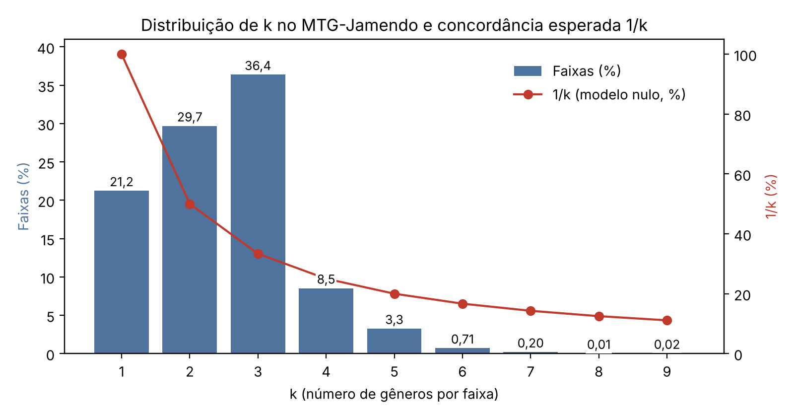

# Gênero musical, rótulos múltiplos e modelo nulo no MTG-Jamendo

**78,8% das faixas do MTG-Jamendo têm mais de um gênero. Se cada uma for reduzida a um único gênero por uma escolha aleatória, duas reduções independentes concordariam em apenas 51,1% das faixas.**

Este repositório reúne o código, os resultados e a identificação das faixas mono e multirrótulo de um estudo sobre o quanto a redução de rótulos múltiplos a uma única categoria depende do critério adotado, usando gêneros musicais como caso de estudo.

**Autores:** Guilherme de Oliveira Aredes, Otávio de Oliveira e Angela Leite Moreno (orientadora), Universidade Federal de Alfenas (UNIFAL-MG).

**Apresentado em:**
- XII Simpósio Integrado de Ensino, Pesquisa e Extensão da UNIFAL-MG (SIEPE 2026), *Arbitrariedade de rótulos de gênero musical: uma análise do MTG-Jamendo*.
- XI Workshop de Matemática e Matemática Aplicada (WMMA 2026), *Quantificando a dependência do critério na redução de rótulos múltiplos a uma única categoria: um estudo de caso em dados musicais*.

---

## O problema

Sistemas de classificação e recomendação costumam exigir um único gênero por música. Mas uma gravação pode pertencer legitimamente a vários gêneros, e anotadores podem discordar sobre o mais adequado (Oramas et al., 2017). Quando uma faixa é "pop e rock", escolher um dos dois depende do critério, e não da música.

Isso é diferente dos **erros** de rotulagem que Sturm (2012, 2014) documentou no GTZAN, como faixas duplicadas e mal classificadas, que levaram às partições *fault-filtered*. Aqui não há erro: há várias respostas corretas.

**Por que medir:** classificadores são avaliados contra um único gênero de referência. Quando a faixa tem vários gêneros válidos, um "erro" do sistema pode ser só outra escolha correta, e a acurácia passa a misturar a capacidade do modelo com a ambiguidade do rótulo.

## Dados

- **Fonte:** [`data/autotagging_genre.tsv`](https://github.com/MTG/mtg-jamendo-dataset/tree/master/data) do repositório oficial do MTG-Jamendo (Bogdanov et al., 2019).
- **Escopo:** 55.215 faixas com pelo menos um gênero e 95 tags de gênero.
- **Quem atribui os gêneros:** os próprios responsáveis pelo envio das faixas na plataforma Jamendo, sem curadoria centralizada.
- Só os metadados são usados: nenhum áudio é baixado e nenhum modelo é treinado.

O arquivo de dados **não** está neste repositório. O notebook o baixa do repositório oficial.

## Método

1. **Dados:** leitura do `autotagging_genre.tsv`.
2. **Contagem:** para cada faixa *i*, *kᵢ* é o número de gêneros distintos. A faixa é multirrótulo quando *kᵢ* > 1.
3. **Modelo nulo:** dois observadores escolhem, de forma independente e com a mesma chance para cada gênero, um dos *k* gêneros da faixa. A probabilidade de coincidirem é

   ```
   P(concordância | k) = 1/k
   ```

4. **Agregação:** a concordância esperada no dataset é a média

   ```
   E[concordância] = (1/N) · Σ 1/kᵢ
   ```

   calculada para todas as faixas e só para as multirrótulo.
5. **Verificação:** simulação de Monte Carlo com 50 e 100 rodadas.
6. **Resultado:** os números abaixo.

Se os observadores compartilham uma preferência *p = (p₁, …, pₖ)*, a concordância passa a Σ pⱼ² ≥ 1/k, com igualdade só no caso uniforme. O modelo nulo é, portanto, o cenário de **menor** concordância: uma referência para comparar com medidas empíricas, e não uma medida de concordância entre pessoas reais.

## Resultados

| Métrica | Valor |
|---|---|
| Faixas com gênero | 55.215 |
| Tags de gênero | 95 |
| Faixas multirrótulo | 43.494 (78,8%) |
| Média de *k* entre as multirrótulo | 2,85 |
| Concordância esperada, todas as faixas | 51,1% |
| Concordância esperada, só multirrótulo | 38,0% |
| Contribuição das faixas com *k* = 1 | 21,2 pontos percentuais |



A maioria das faixas tem 2 ou 3 gêneros, justamente onde o acaso concorda em só 50% ou 33%. Sem um critério explícito e compartilhado, duas reduções discordariam em cerca de metade do catálogo e em 62% das faixas multirrótulo.

Como há tags que especializam outras (por exemplo, *rock* e *poprock*), contadas aqui como gêneros diferentes, os valores são uma estimativa conservadora da concordância.

### Verificação por Monte Carlo

| Rodadas | Concordância simulada (todas) | Concordância simulada (multi) | Fórmula (todas) | Fórmula (multi) |
|---|---|---|---|---|
| 50 | 51,16% | 38,00% | 51,13% | 37,95% |
| 100 | 51,14% | 37,98% | 51,13% | 37,95% |

### A métrica antiga e por que foi substituída

Uma versão anterior media a "instabilidade" do rótulo: a lista de gêneros era reordenada *R* vezes, e a faixa era instável se o primeiro gênero mudasse em alguma rodada. A simulação mostra que essa medida converge para a própria proporção de faixas multirrótulo, ou seja, é consequência mecânica dela, e não um achado independente:

| Rodadas | Faixas instáveis | Proporção multirrótulo |
|---|---|---|
| 5 | 76,4% | 78,8% |
| 50 | 78,8% | 78,8% |
| 100 | 78,8% | 78,8% |

Por isso ela foi substituída pelo modelo nulo, que tem forma fechada e não depende do número de rodadas.

## O que este trabalho disponibiliza

- **`resultados/faixas_mono_multi.csv`**: identificação de cada uma das 55.215 faixas como mono ou multirrótulo, com *k* e a lista de gêneros. De forma análoga às partições *fault-filtered* de Sturm (2014) para o GTZAN, permite avaliar sistemas de classificação e recomendação **separadamente** em cada subconjunto, sem confundir erro do modelo com ambiguidade do rótulo.
- **Um modelo nulo geral**, aplicável a qualquer redução de multirrótulo para rótulo único usada como pré-processamento, dentro ou fora da música.
- **O notebook completo**, que reproduz todos os números e a figura em segundos.

Colunas de `faixas_mono_multi.csv`:

| Coluna | Conteúdo |
|---|---|
| `track_id`, `artist_id`, `album_id` | Identificadores do MTG-Jamendo |
| `k` | Número de gêneros distintos |
| `multirrotulo` | `True` se *k* > 1 |
| `generos` | Gêneros da faixa, separados por `\|` |

## Como reproduzir

**Google Colab:** abra `analise_modelo_nulo.ipynb` no Colab (Arquivo → Abrir notebook → GitHub, e cole o endereço deste repositório) e execute todas as células. O arquivo de dados é baixado automaticamente.

**Local:**

```bash
pip install -r requirements.txt
jupyter notebook analise_modelo_nulo.ipynb
```

A simulação usa semente fixa (`42`), então os números se repetem a cada execução.

## Estrutura

```
.
├── analise_modelo_nulo.ipynb      # análise completa, com as saídas
├── resultados/
│   ├── faixas_mono_multi.csv      # faixas mono e multirrótulo
│   ├── distribuicao_k.csv         # quantas faixas têm cada k
│   ├── resumo.csv                 # números principais
│   ├── monte_carlo.csv            # verificação por simulação
│   └── metrica_antiga.csv         # convergência da métrica de instabilidade
├── figuras/
│   ├── distribuicao_k_1k.png
│   └── distribuicao_k_1k.pdf
├── requirements.txt
├── LICENSE
└── README.md
```

## Limitações e trabalhos futuros

- Um único dataset, e só os metadados das faixas, sem o áudio.
- A escolha uniforme é uma hipótese de referência: pessoas reais têm preferências.
- As tags foram tratadas como independentes, sem agrupar sinônimos ou hierarquias.

Como trabalhos futuros: aplicar o método a outros datasets multirrótulo e investigar como o conteúdo musical pode ser integrado ao modelo.

## Licença

- **Código** (notebook): MIT, ver `LICENSE`.
- **Dados derivados** (`resultados/`): derivados do MTG-Jamendo, distribuídos sob a mesma licença dos metadados originais, [CC BY-NC-SA 4.0](https://creativecommons.org/licenses/by-nc-sa/4.0/). Ao usá-los, cite também o MTG-Jamendo.

## Referências

- Bogdanov, D., Won, M., Tovstogan, P., Porter, A., & Serra, X. (2019). The MTG-Jamendo Dataset for Automatic Music Tagging. *ML4MD Workshop, ICML 2019*.
- Oramas, S., Nieto, O., Barbieri, F., & Serra, X. (2017). Multi-label music genre classification from audio, text, and images using deep features. *ISMIR 2017*.
- Sturm, B. L. (2012). An analysis of the GTZAN music genre dataset. *2nd ACM Workshop on Music Information Retrieval (MIRUM)*, 7–12.
- Sturm, B. L. (2014). The GTZAN dataset: Its contents, its faults, their effects on evaluation, and its future use. *Journal of New Music Research*, 43(2), 147–172.

---

Trabalho desenvolvido no âmbito da Iniciação Científica da UNIFAL-MG.
